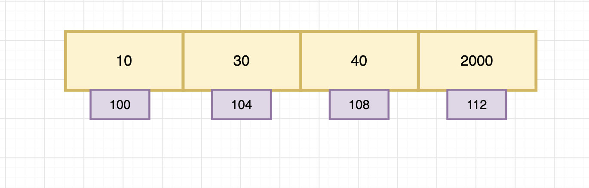
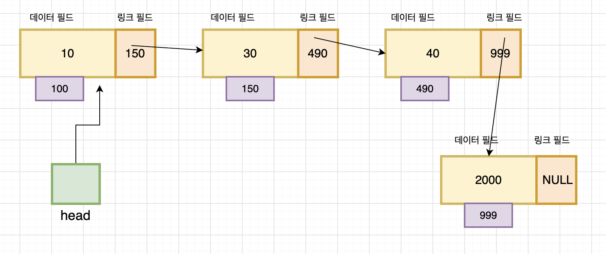
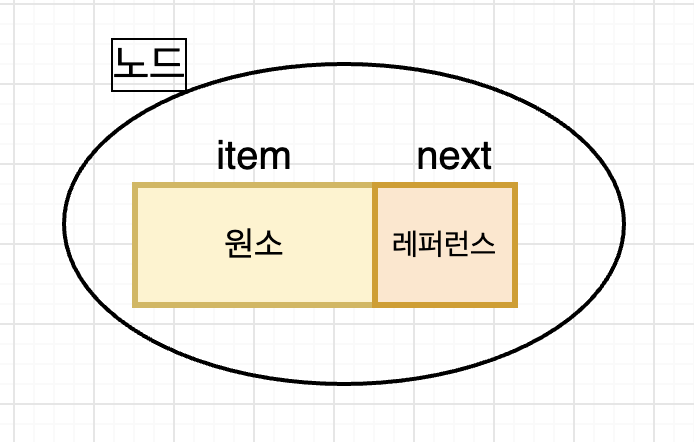

작성 일자: 2026/11/3 ~ 2026/11/8  <br>
(알고리즘, 구현은 작성 X)

## 🟩 ADT (추상 데이터타입)이란? 
먼저 자료구조에서 사용하는 용어인 ADT(Abstract Data Type)에 대해서 알고 가자. 

ADT란, *데이터와 사용할 수 있는 연산을 정의하는 개념*이다. 

즉, 자료형을 말할때, 내부 구현의 구체적인 내용은 제외하고, *해당 자료형이 사용할 데이터(자료형)와 어떤 연산(어떤 동작을 할 것인지)을 하는지, 마지막으로 각 연산이 어떤 결과를 만들어야하는지*에 대해서 정의한 타입이다. 


이해가 좀 어려울 수도 있는데, 말그대로 추상 데이터 타입니다. 자바에서 우리가 interface를 사용하여 *추상화*를 시켜 코드에 사용하는것과 비슷한 개념이다. 
데이터에 순서가 있는 자료구조인 list로 예를 들자면, 리스트 ADT는 다음과 같을 것이다. <br>

### 🟣 리스트 ADT (예시)
````text
• i번째 자리에 원소 x를 삽입한다
• i번째 원소를 삭제한다
• 원소 x를 삭제한다
• i번째 원소를 알려준다
• 원소 x가 몇 번째 원소인지 알려준다
• 리스트의 사이즈(원소의 총 수)를 알려준다
````


## 🟩 리스트, 리스트 ADT란?

리스트란 내부 요소(원소)에 순서와 위치가 있는 데이터 형식을 포괄적으로 부르는 용어이다. 

- 첫 번째, 두 번째 처럼 위치를 구분할 수 있고, 
- 같은 값이 여러 번 들어갈 수 있다.

이러한 특징을 가진 자료형을 포괄적으로 부르는 용어가 리스트이다. <br>

이에 우리는 리스트 ADT를 만들어 이 리스트라는 자료구조가 어떤 데이터를 다룰 것인지, 또한 어떤 연산을 제공하고 어떤 결과를 반환할 것 인지에 대해서 정한다. 다시 말하지만, ADT이기때문에, 내부구현에는 집중하지 않고 이 자료구조가 무엇을 할 수 있는지(어떤 데이터를 다루고, 어떤 연살과 결과를 제공하는지)에 대해서만 정하는 것이다. 내부 구현은 

아래는 리스트 ADT의 예시이다. 
````text
• i번째 자리에 원소 x를 삽입한다
• i번째 원소를 삭제한다
• 원소 x를 삭제한다
• i번째 원소를 알려준다
• 원소 x가 몇 번째 원소인지 알려준다
• 리스트의 사이즈(원소의 총 수)를 알려준다
````
필요에 따라 이 작업 목록은 얼마든지 더하거나 뺼 수 있다. 


## 🟩 리스트 구현하기
이제 리스트 ADT를 구현해보자. 크게 배열 리스트, 연결 리스트 두가지 방법이 있다. 각각 살펴보자. 

### 🟩 배열 리스트


배열 리스트는 말그대로 리스트를 배열로 구현한 것이다. 

시작 위치부터 빈자리 없이 자료를 순서대로 메모리 공간에 연속하여 저장하므로, 논리적인 순서와 물리적인 순서가 일치하고, 원소를 삽입하거나 삭제해도 빈자리없이 자료가 순서대로 연속하여 저장된다.

단순하고 효율성이 높다는 장점이 있지만, 단점도 크다. 
공간을 낭비하지 않으려면 배열의 크기를 빠듯하게 잡아놓아야하는데, 이 경우 다차면 더 큰 배열을 할당받아 원소를 모두 옮겨주는 작업을 자주해야하므로 상당히 번거롭다.


### 🟩 연결 리스트 



연결리스트는 배열 리스트의 공간 낭비 문제를 피할 수 있는 자료구조 이다. 
원소가 추가될 때 마다 공간을 할당받아 추가하는 동적 할당 방식을 따르기 때문이다. 

연결 리스트에 저장되는 데이터를 노드라고 부르는 데, 이 노드는 원소를 저장하는 필드 item과 다음 노드를 가리키는 필드 next로 구성 된다. 

위에 사진(연결 리스트의 기본 형태이다)을 참고했을때, 첫번째 노드를 가리키는 레처런스 head가 있고, 맨 마지막 노드의 링크는 뒤에 더 이상 노드가 없다는 의미로 null값을 할당한다. 배열 처럼 연속된 공간을 할당받는 것이 아니기 때문에, 우너소들을 조간조각 할당받은 공간끼리 링크로 연결한다. 




해당 리스트 노드에 접근하기 위해서는 반드시 head 값을 통해서 첫 번쨰 노드를 참조하고, 그에 따라서 순차적으로 링크를 따라서 노드들을 탐색할 수 있기때문에, 맨뒤에 있는 노드에 접근하려고 한다고 하더라도 첫 번째 노드부터 맨 뒤에 있는 노드까지 전부 순차적으로 참조해야한다는 단점도 생긴다. (물론 나중에 이러한 단점을 해결하기 위한 연결리스트 확장 방법도 있다.)


## 🟩 알고리즘 및 구현

추후 작성 예정..